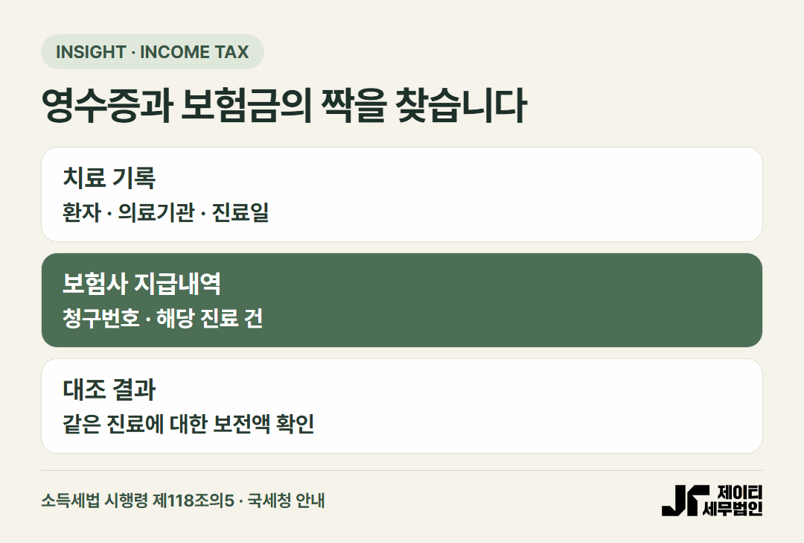
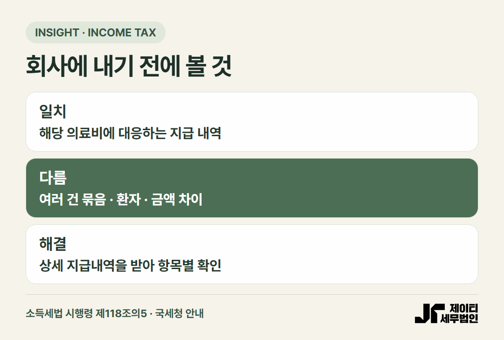

2026년에 병원비를 냈고 그 치료비를 실손보험으로 돌려받았다면 **그 진료를 보전한 실손보험금을 공제대상 의료비에서 제외합니다.** 카드·현금 등 결제수단과 관계없이, 누구의 어떤 진료비를 얼마만큼 보전받았는지 확인하는 것이 출발점입니다. 다음은 의료비 지급과 해당 실손보험금 수령이 모두 2026년에 있었던 근로자의 정리 방법입니다.

## 병원에 낸 금액과 실제 부담한 의료비를 구분합니다

소득세법 제59조의4 제2항은 일용근로자를 제외한 근로소득이 있는 거주자가 기본공제대상자(나이와 소득의 제한을 받지 않음)를 위해 해당 과세기간에 법령에서 정한 의료비를 지급한 경우의 세액공제를 규정합니다. 같은 법 시행령 제118조의5 제1항은 근로자가 직접 부담하는 의료비를 대상으로 정하고, 규정된 기관에서 지급받은 실손의료보험금은 제외합니다.

간소화에서 조회한 의료비나 병원 영수증은 의료기관에 지급한 기록입니다. 여기에 보험사 지급내역을 대조해 해당 진료로 보전받은 금액을 구분합니다. 실제 부담한 금액 중 공제 대상에 들어가는 범위와 최종 공제액은 의료비 종류, 대상자와 별도 공제 요건을 함께 확인해야 합니다.

<figure style="margin:24px 0"><figcaption>환자와 진료 건을 기준으로 영수증과 보험금 지급내역을 짝지어 봅니다.</figcaption></figure>

## 보험금 한 번에 여러 진료분이 섞였으면 무엇부터 보나요?

가령 한 사람이 같은 달에 진료를 세 차례 받고 모아 한 번 청구했다고 해보겠습니다. 보험금이 한 번에 입금돼도 입금 내역만으로 세 진료별 보전액을 구분하기는 어렵습니다. 청구번호가 붙은 상세 지급내역을 열어 환자와 진료기관, 해당 진료일을 영수증과 맞춥니다. 입금 메모는 지급 사실을 확인하는 보조 자료로 둡니다.

지급내역에서 여러 환자나 진료기관의 자료가 섞여 있다면 항목별로 해당 병원 영수증을 붙이세요. 지급 구분이 명확하지 않다면 보험사에 보전 대상과 항목별 금액을 문의합니다. 구분 근거를 확보하면 다른 진료분에 동일한 보험금을 거듭 반영하는 실수를 줄일 수 있습니다.

## 회사에 제출하기 전 마지막으로 확인할 항목

| 확인 순서 | 자료를 보는 방법 |
| --- | --- |
| 의료비 지급 내역 | 간소화 의료비와 실제 수납 영수증에서 대상자와 지급분을 확인합니다. |
| 보험금 수령 내역 | 보전 대상 진료와 항목을 보험사 상세 지급자료에서 찾습니다. |
| 차이가 남은 경우 | 지급내역의 발급 기관에 확인하고 필요하면 회사 담당자에게 제출 방법을 묻습니다. |

이미 제출했는데 보험금을 뒤늦게 받았거나, 의료비를 낸 해와 보험금 수령 연도가 다른 경우에는 원래의 진료비 지급 자료, 수령일, 해당 의료비가 공제에 포함됐는지 확인해 담당자와 정정 필요성을 검토하세요. 여기서 안내한 정리 방법은 같은 해 지출·수령을 전제로 합니다.

<figure style="margin:24px 0"><figcaption>병원 영수증과 보험사 지급자료에서 차이가 남는 항목을 확인합니다.</figcaption></figure>

## 자주 묻는 질문

**가족 진료비를 제가 냈고 보험금은 가족 계좌로 받았습니다.** 어떤 의료비를 보전한 보험금인지 보험금 지급 명세에서 확인하세요. 누가 의료비를 실제 부담했고 공제 요건에 해당하는지도 함께 확인할 사항입니다.

**실손보험금만큼 세금이 그대로 늘어나는 건가요?** 실손보험금은 공제 대상에 넣을 의료비를 정리하는 단계에서 제외합니다. 최종 의료비 공제는 그다음에 공제 요건과 구간을 적용해 확인합니다.

**간소화 자료와 보험사 금액이 다릅니다.** 조회 시점과 지급 내역의 대상자를 먼저 확인하세요. 상세 지급 증빙을 받아 회사의 제출 방식에 맞춰 차이를 설명할 수 있게 준비합니다.

## 확인 근거와 관련 안내

- [소득세법 제59조의4](https://www.law.go.kr/법령/소득세법/제59조의4) [API 확인]
- [소득세법 시행령 제118조의5](https://www.law.go.kr/법령/소득세법시행령/제118조의5) [API 확인]
- [국세청 연말정산 자주 묻는 질문과 안내](https://www.nts.go.kr/nts/na/ntt/selectNttInfo.do?mi=2201&nttSn=1348212) [웹검색 확인]
- [국세청 연말정산 안내](https://www.nts.go.kr/nts/cm/cntnts/cntntsView.do?cntntsId=7874&mi=2303) [웹검색 확인]
- [이사한 해의 월세 세액공제](https://www.jttax.co.kr/insights/year-end-rent-tax-credit-midyear-move-2026.html)

법령 확인일은 2026년 11월 26일입니다.
