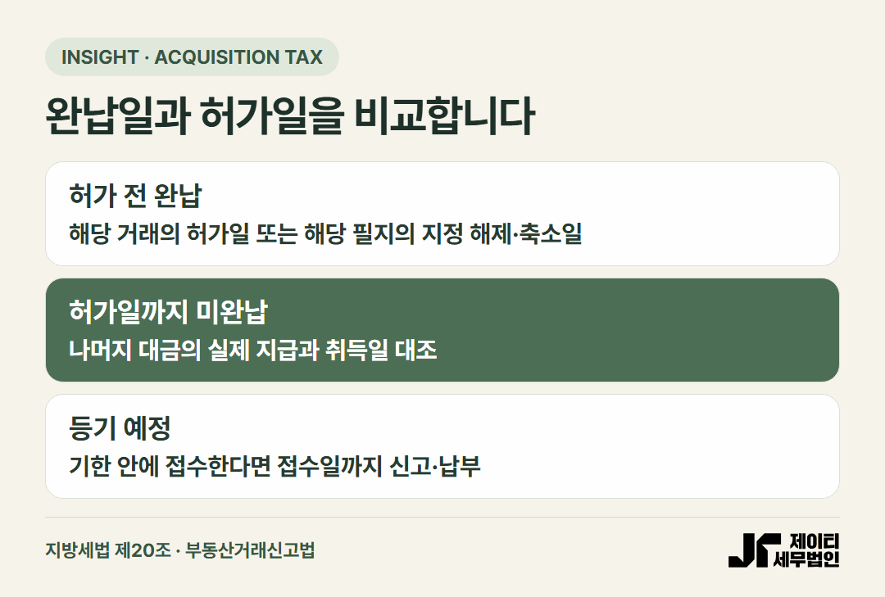
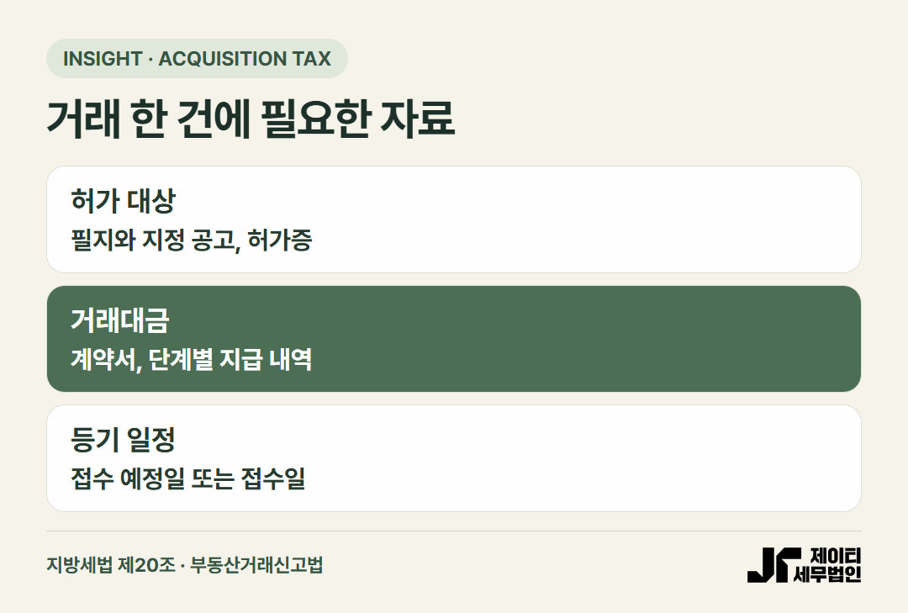

허가가 필요한 토지거래에서 **허가를 받기 전에 거래대금을 전부 지급했다면** 취득세 신고·납부 기간의 기준일은 허가일 또는 해당 거래에 적용되는 허가구역 지정 해제일·축소일입니다. 그날부터 60일 이내에 취득세를 신고·납부합니다. 그 기간 안에 이전등기를 하려는 거래라면 등기 신청서를 접수하는 날도 함께 확인합니다.

## 거래 대상이 실제 허가 범위에 들어가는지 확인합니다

같은 동네에 있는 땅이라도 허가구역 지정 공고의 범위와 내용, 거래하는 사람과 토지의 요건에 따라 허가 여부가 다를 수 있습니다. 주소로 지도를 한 번 보는 데 그치지 말고 필지와 지정 공고, 해당 거래의 허가 신청 및 처리 자료를 함께 놓습니다. 허가 면적·대상 등을 구체적으로 확인하려면 거래를 관할하는 시·군·구에 문의하세요.

지방세법 제20조 제1항은 토지거래계약 허가구역의 토지를 취득하면서 허가 전에 **거래대금을 완납한 경우**를 별도로 규정합니다. 계약금이나 일부 대금을 먼저 지급했지만 허가 전에 대금이 모두 정리되지 않았다면 이 완납 규정을 적용하는 경우와 구별합니다.

<figure style="margin:24px 0"><figcaption>허가 전 완납인지와 실제 허가일 또는 적용되는 지정 변경일을 확인합니다.</figcaption></figure>

## 완납일과 허가일이 다르면 무엇을 확인하나요?

가령 허가신청을 한 뒤 이미 거래대금을 전부 건넸고 관할 구청이 이후 허가했다고 가정해 보겠습니다. 먼저 매매계약서와 지급증빙을 대조해 허가 전에 완납했는지 확인합니다. 조건을 충족하고 이후 허가를 받았다면 신고·납부 기간은 허가일부터 확인합니다. 계약서의 잔금 예정일과 실제 완납일이 다를 수 있으므로 지급 증빙을 같이 봅니다.

반대로 허가 전에 계약금만 지급했고 대금이 남아 있다면, 그 사실만으로 허가일을 취득세 신고기한의 기준일로 잡을 수 없습니다. 일반 규정상 취득한 날과 등기 접수 계획을 함께 확인합니다. 허가 전에 모두 지급했으나 허가구역의 지정이 해제 또는 축소됐다면, 거래 필지가 변경 범위에 포함되는지와 적용 날짜를 공고에서 확인합니다. 이 글은 이미 발생한 지급과 신고기한을 검토하는 일반 사례를 다룹니다. 허가 전 완납 규정은 취득세 신고기한에 관한 설명입니다. 허가와 계약 효력은 실제 허가 처리 상태를 확인한 뒤 관할 부서에 문의하세요.

## 기존 계약 자료 옆에 등기 접수 계획을 적습니다

| 필요한 자료 | 확인할 항목 |
| --- | --- |
| 허가 신청 접수증과 허가증 | 신청일과 실제 허가일, 해당 필지 |
| 계약서·변경 합의·이체 기록 | 약정 지급일과 실제 거래대금 완납일 |
| 허가구역 공고 또는 등기 접수 기록 | 해당 필지에 적용되는 지정 변경일, 등기 신청 접수일 |

지방세법 제20조 제4항은 법정 신고·납부기간 안에 권리를 등기하거나 등록하려는 경우 **등기·등록 신청서를 접수하는 날까지** 취득세를 신고·납부하도록 합니다. 중개사 사무소에서 허가·지급 자료를 확인했다면, 고객 동의 범위에서 이를 법무사와 전달해 접수 예정일이 언제인지 확인하세요.

<figure style="margin:24px 0"><figcaption>계약, 거래대금 지급, 허가, 등기 접수의 증빙을 따로 정리합니다.</figcaption></figure>

## 자주 묻는 질문

**매매계약서에 기재된 잔금일만 보면 되나요?** 지급일이 달라진 사유와 실제 대금 지급 기록을 확인합니다. 허가 전에 완납했는지부터 판단해야 합니다.

**허가가 늦게 나왔는데 신청일부터 세나요?** 이 경우에는 해당 거래의 허가일을 확인합니다. 허가일이나 다른 기준이 적용되는지는 허가증과 관할 기관의 자료로 대조하세요.

**허가구역 축소 소식이 들리면 무엇을 챙겨야 하나요?** 공고명과 적용일, 해당 필지가 실제로 제외됐는지를 확인해서 관할 부서에 거래별 기준을 물어보세요.

## 확인 근거와 관련 안내

- [지방세법 제20조](https://www.law.go.kr/법령/지방세법/제20조) [API 확인]
- [부동산 거래신고 등에 관한 법률 제10조](https://www.law.go.kr/법령/부동산거래신고등에관한법률/제10조) [API 확인]
- [부동산 거래신고 등에 관한 법률 제11조](https://www.law.go.kr/법령/부동산거래신고등에관한법률/제11조) [API 확인]
- [취득세의 일반적인 취득일](https://www.jttax.co.kr/insights/acquisition-tax-acquisition-date.html)
- [공인중개사 협업 안내](https://www.jttax.co.kr/desk/broker.html)

법령 확인일은 2026년 11월 27일입니다.
