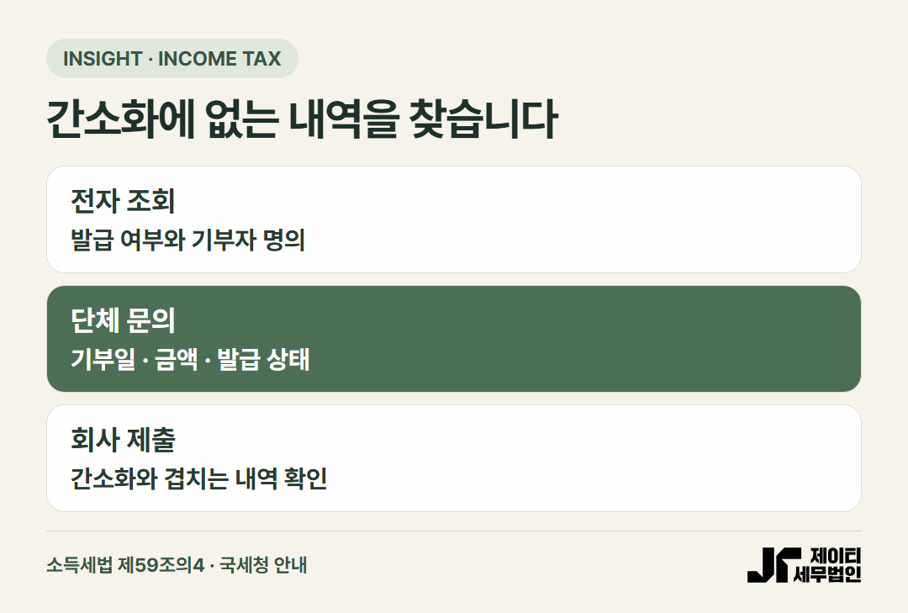
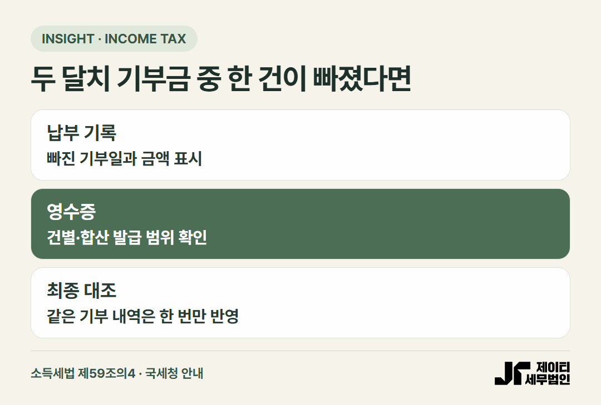

2026년에 기부한 내역이 연말정산 간소화에서 보이지 않는다면 **전자기부금영수증 발급 여부와 해당 기부 건을 먼저 확인**하세요. 간소화 조회가 되지 않으면 기부금단체에서 필요한 증빙을 발급받을 수 있습니다. 전자 발급이 누락된 경우 홈택스에서 발급을 요청할 수도 있습니다. 단체가 기부 내역을 확인한 뒤 영수증을 발급할 수 있습니다.

## 기부 결제 기록과 영수증 발급 기록을 따로 봅니다

간소화 내역에서 먼저 확인할 것은 기부금단체와 기부자 명의, 실제 기부 금액입니다. 통장 입금 내역이나 카드 결제 내역은 어느 날 어느 곳에 얼마를 보냈는지 확인하는 데 도움이 됩니다. 그 기록에 있는 결제 상대가 기부금영수증 발급처와 다른 경우 모금 안내나 단체의 문의 창구에서 발급처를 확인합니다.

국세청 안내에 따르면 전자기부금영수증 발급 내역은 연말정산 간소화에 반영됩니다. 홈택스에서 이미 발급된 자료를 확인한 뒤, 간소화에서 찾지 못한 내역은 발급 상태와 해당 연도를 차례로 대조합니다.

<figure style="margin:24px 0"><figcaption>전자기부금영수증 발급 여부와 단체, 기부자 및 금액을 대조합니다.</figcaption></figure>

## 단체에서 한 번에 발급한 영수증이면 포함 범위를 확인합니다

가령 가을에 한 단체에 두 차례 기부했고 조회 자료에는 한 건만 보였다고 가정해 보겠습니다. 영수증이 건별로 발급된 것인지, 특정 기간의 기부액을 합쳐 발급한 것인지부터 확인합니다. 기부일과 결제액을 대조해 조회된 영수증이 두 기부를 모두 포함하는지 확인하면 자료를 이중으로 제출하는 일을 줄일 수 있습니다.

발급이 누락됐으면 홈택스에서 발급을 요청하거나 단체에 직접 문의할 수 있습니다. 단체에 이미 전자 발급했는지, 어느 기부 내역이 반영됐는지와 발급에 필요한 정보를 확인합니다. 간소화에서 조회되지 않아 직접 받은 자료는 회사 연말정산 담당자에게 제출 방법을 문의하세요.

## 증빙 대조와 세액공제 요건은 순서대로 확인합니다

| 확인 대상 | 대조 방법 |
| --- | --- |
| 실제 기부 자료 | 지급일, 지급 금액과 이전에 접수된 내역 확인 |
| 전자·별도 발급 영수증 | 기부일, 기부자, 기부처, 금액과 기존 반영 범위 확인 |
| 최종 회사 제출 내역 | 추가 서류가 필요한 건과 간소화에 이미 들어 있는 건을 표시 |

소득세법 제59조의4 제4항은 특례기부금과 일반기부금에 관한 세액공제 범위를 정합니다. 같은 조 제6항에 따라 공제를 받으려면 법령이 정한 절차대로 신청해야 합니다. 증빙을 발급받은 다음에는 공제대상 기부금인지, 누가 신청하는지 등 요건을 따로 확인하세요. 이 글은 2026년 귀속 근로자 본인의 증빙 준비 절차를 설명합니다.

<figure style="margin:24px 0"><figcaption>기부금을 합산 발급받았다면 어떤 내역이 포함됐는지 확인합니다.</figcaption></figure>

## 자주 묻는 질문

**플랫폼 결제 화면에는 보이는데 기부금 항목에는 없어요.** 모금 안내에 기재된 실제 기부금 수령처와 영수증 발급처를 확인하세요. 발급처에는 기부일과 금액을 표시한 기록을 준비해 문의합니다.

**같은 날짜에 같은 금액을 두 번 기부한 경우에는 어떻게 확인하나요?** 영수증 한 건만 보고 중복 여부를 정하기 어렵습니다. 결제 내역과 단체의 발급 내역을 대조해 서로 다른 기부가 각각 들어 있는지 확인하세요.

**회사에 이미 제출했는데 영수증을 뒤늦게 받았어요.** 그 기부 건이 실제 제출한 내역에 포함됐는지 확인하고, 회사 담당자에게 자료를 더 낼 수 있는 시점과 필요한 방식을 문의하세요.

## 확인 근거와 관련 안내

- [소득세법 제59조의4](https://www.law.go.kr/법령/소득세법/제59조의4) [API 확인]
- [국세청 전자기부금영수증 제도](https://www.nts.go.kr/nts/cm/cntnts/cntntsView.do?cntntsId=238907&mi=40251) [웹검색 확인]
- [국세청 전자기부금영수증 발급 안내](https://www.nts.go.kr/nts/cm/cntnts/cntntsView.do?cntntsId=238908&mi=40252) [웹검색 확인]
- [국세청 연말정산 간소화 누락 자료 안내](https://www.nts.go.kr/nts/na/ntt/selectNttInfo.do?mi=2201&nttSn=1347979) [웹검색 확인]
- [연말정산 간소화자료 제공동의 안내](https://www.jttax.co.kr/insights/year-end-tax-data-consent-2026.html)

법령 확인일은 2026년 11월 27일입니다.
