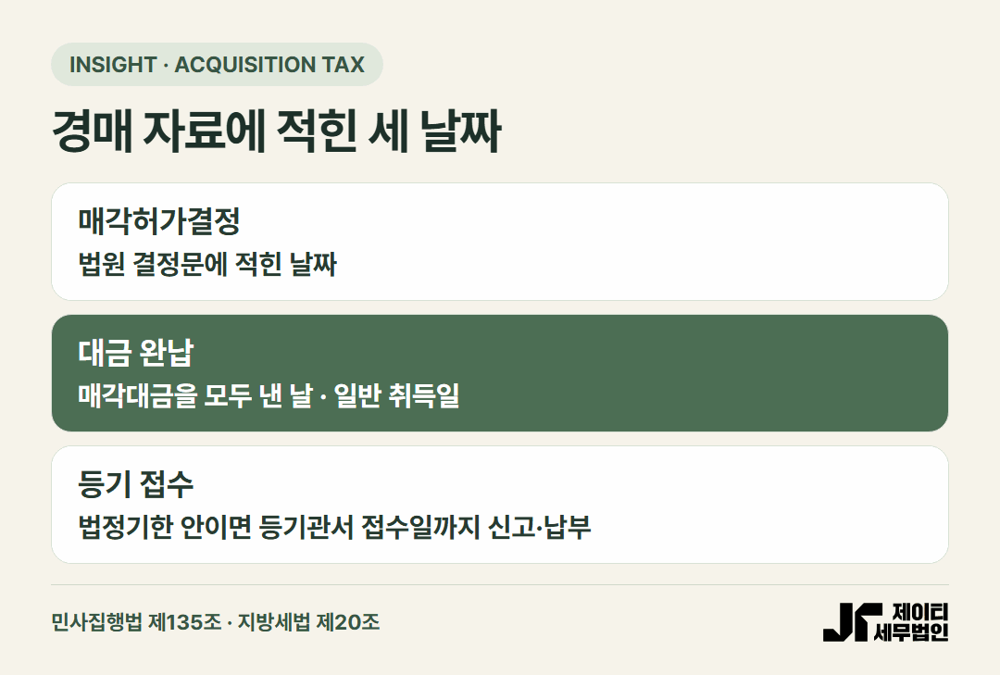
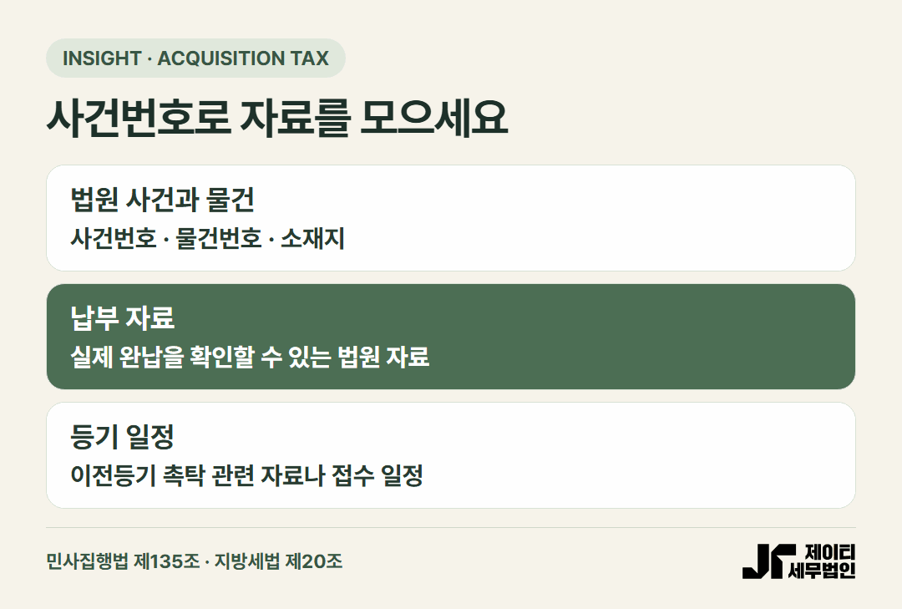

일반적인 법원 부동산 경매에서 매수인이 **매각대금을 모두 낸 날**을 취득세 신고기한의 출발점으로 확인합니다. 매각허가결정이 난 날이나 등기가 끝난 날과 다를 수 있으니, 사건별 법원 대금 완납 자료부터 확인하세요. 이 글은 매수인이 법원에 직접 대금을 완납하는 경우를 설명합니다.

## 법원 결정일과 실제 완납일을 구분합니다

민사집행법 제135조는 매수인이 매각대금을 모두 낸 때에 매각의 목적인 권리를 취득한다고 규정합니다. 지방세법 시행령 제20조 제2항도 유상으로 승계취득하는 경우 사실상의 잔금지급일을 일반 취득일로 정합니다. 법원 경매에서는 사건기록에 있는 실제 완납일을 기준으로 자료를 대조합니다.

가령 한 사람이 주택을 낙찰받아 법원의 매각허가결정을 받은 뒤, 법원이 정한 대금지급기한에 앞서 매각대금을 전부 냈습니다. 결정문은 매각 대상과 매수인을 대조하는 데 쓰고, 취득일을 확인하는 자료는 완납을 보여 주는 법원 기록입니다. 대금지급기한 통지서 날짜와 실제 지급일을 한 칸에 적으면 다르게 움직인 두 날짜를 놓치기 쉽습니다.

<figure style="margin:24px 0"><figcaption>매각허가결정일, 실제 대금 완납일과 등기 접수일을 따로 표시합니다.</figcaption></figure>

## 등기 접수일은 신고·납부기한과 연결됩니다

지방세법 제20조 제1항에 따르면 취득세는 일반적으로 취득일부터 60일 이내에 신고·납부합니다. 제4항은 그 신고·납부기간 안에 권리의 취득·이전을 등기하려는 경우 등기 신청서를 접수하는 날까지 신고·납부하도록 합니다. 매각대금을 모두 낸 뒤에는 법정기한과 이전등기 접수 일정을 함께 확인하세요.

대금을 다 냈지만 등기 접수 일정이 아직 잡히지 않은 경우에도 신고기한은 확인해 두어야 합니다. 법원으로부터 이전등기 촉탁에 필요한 준비를 안내받았다면, 등기 업무를 맡은 사무소에 법원에 촉탁 관련 서류를 내는 날과 등기관서에 접수되는 날을 구분해 보고, 취득세 신고·납부 증빙을 어떻게 전달할지 물어보세요.

## 같은 사건의 날짜와 물건이 맞는지 확인합니다

| 자료 | 찾아 적을 항목 |
| --- | --- |
| 매각허가결정 자료 | 사건번호, 물건번호, 매수인 이름, 매각 대상 |
| 매각대금 납부 자료 | 실제 완납일, 물건과 매수인 일치 여부 |
| 등기 접수나 촉탁 관련 자료 | 등기 대상과 접수 예정일 또는 실제 접수일 |

같은 법원에서 물건을 두 건 취득했다면 우선 어떤 완납 자료가 어느 물건에 대응하는지 나누어 둡니다. 통장 이체 내역은 지급을 뒷받침하는 자료로 활용하고 법원에 실제로 어떤 대금이 반영됐는지 확인하세요. 차액지급이나 채무인수처럼 지급 방식이 일반 현금 납부와 다른 경우에는 법원 및 취득세 담당 부서에 해당 사건의 완납 처리와 취득일을 확인합니다.

<figure style="margin:24px 0"><figcaption>같은 사건과 물건의 법원 자료, 납부자료와 등기 일정을 함께 맞춥니다.</figcaption></figure>

## 자주 묻는 질문

**법원 통지서에 대금 납부 마감일이 나와 있습니다.** 실제 매각대금을 모두 납부한 날을 법원 자료에서 확인하세요.

**등기 접수 뒤 취득세를 신고해도 되나요?** 법정 신고·납부기간 안에 등기를 하려는 경우에는 신청서를 접수하는 날까지 신고·납부해야 합니다.

**매각물건이 건물과 그 부속 토지인 경우에는요?** 매각 목록에 적힌 취득 대상과 각 물건의 납부 기록이 맞는지 확인해 등기와 신고 자료를 준비하세요.

## 확인 근거와 관련 안내

- [민사집행법 제135조](https://www.law.go.kr/법령/민사집행법/제135조) [API 확인]
- [지방세법 제20조](https://www.law.go.kr/법령/지방세법/제20조) [API 확인]
- [지방세법 시행령 제20조](https://www.law.go.kr/법령/지방세법시행령/제20조) [API 확인]
- [일반 매매의 취득일 안내](https://www.jttax.co.kr/insights/acquisition-tax-acquisition-date.html)
- [법무사 협업 안내](https://www.jttax.co.kr/desk/scrivener.html)

법령 확인일은 2026년 11월 28일입니다.
