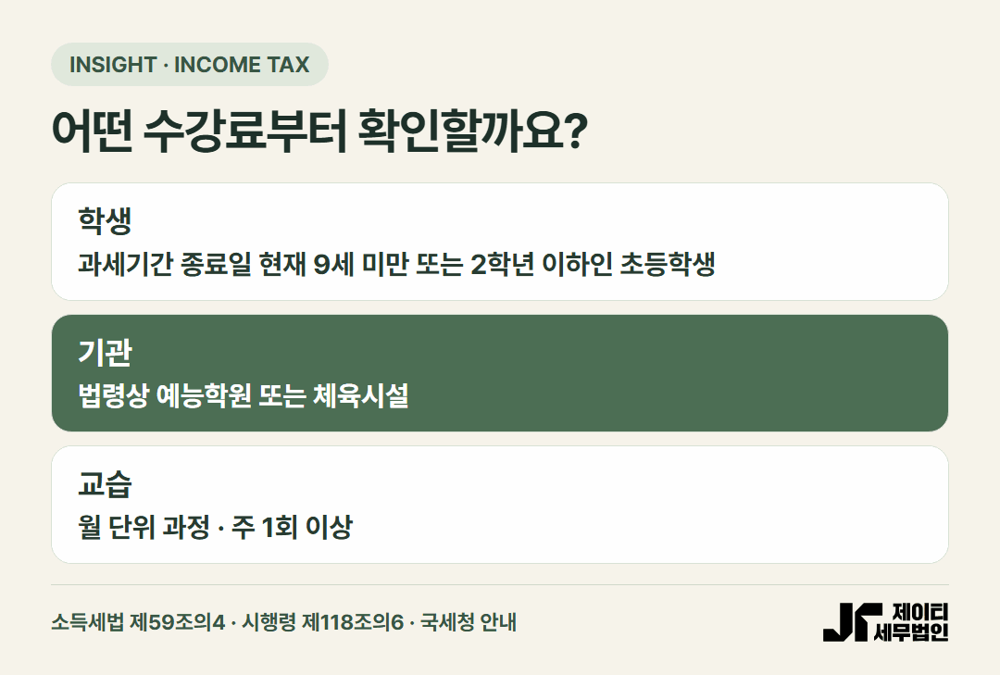
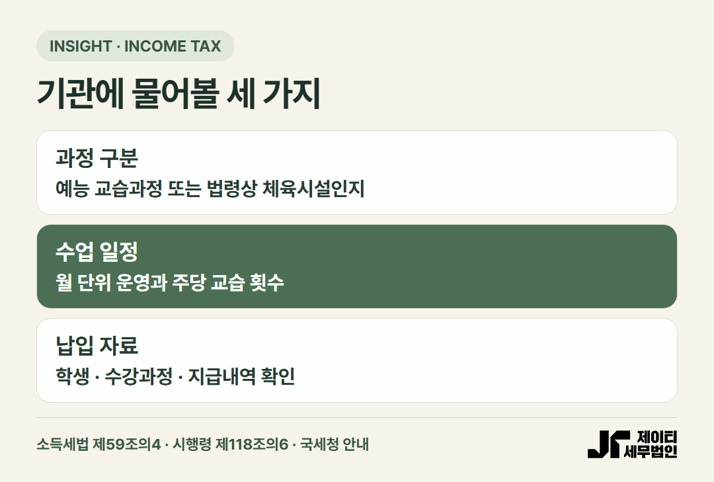

2026년 귀속 연말정산에서는 **과세기간 종료일 현재 9세 미만 또는 2학년 이하인 초등학생**이 요건에 맞는 예능학원·체육시설 교습과정에 지출한 수강료를 교육비 세액공제 대상으로 검토할 수 있습니다. 학생의 연말 학년·나이, 기관과 과정, 실제 수강료 지급 내역을 차례로 확인합니다. 2026년 1월 1일 이후 지급한 교육비부터 적용됩니다. 이 글은 일용근로자를 제외한 근로소득이 있는 거주자가 기본공제대상 자녀를 위해 해당 과세기간에 낸 수강료를 다룹니다.

## 학년과 연령은 과세기간 종료일 기준입니다

소득세법 제59조의4 제3항 제1호 마목은 초등학생 가운데 과세기간 종료일 현재 9세 미만이거나 2학년 이하인 학생을 대상으로 정합니다. 가령 2026년 말에 이미 만 9세인 초등학생이라도 그 시점에 2학년이라면 학년 요건을 충족합니다. 이때 기관과 수업 요건까지 맞는지를 확인해야 합니다.

별도로 취학 전 아동에게 적용하는 교육비 규정도 있습니다. 이번 안내는 학교에 다니는 초등학생의 예능·체육 교육비에 범위를 두며, 지출한 연도의 종료일 기준으로 적용 요건을 확인합니다.

<figure style="margin:24px 0"><figcaption>학생의 종료일 나이·학년과 기관 및 교습과정의 요건을 함께 확인합니다.</figcaption></figure>

## 예능학원과 체육시설은 무엇을 확인하나요?

소득세법 시행령 제118조의6 제8항은 학원법 시행령 별표 2의 예능분야 교습과정을 운영하는 학원을 규정합니다. 비용을 낸 과정 자체도 해당 예능 교습과정이어야 합니다. 같은 기관에서 예능 수강과 별개의 교과 수강을 함께 결제했다면, 학원에 과정별 납입 내역을 확인합니다.

체육은 같은 조 제9항이 제6항 각 호에 연결됩니다. 체육시설업자가 운영하는 시설 등 법령이 정한 시설이 해당하는지 확인하세요. 상호에 운동 종목이 적혀 있다는 정보만으로는 시설의 법적 요건을 확인하기 어렵습니다.

## 월 단위 과정인지와 실제 수강료를 맞춰 봅니다

시행령 제118조의6 제10항이 정한 수강료는 요건에 맞는 학원·체육시설에서 교습을 받고 낸 금액입니다. 과정은 월 단위로 실시하고 한 주에 한 번 이상 교습해야 합니다. 음악 수업을 한 달간 주마다 수강하는 사례와 하루의 체험 수업을 신청한 사례는 과정 운영이 다릅니다. 결제일만으로 정하기보다 해당 반의 수업 기간과 주당 횟수를 대조합니다.

| 준비하는 자료 | 확인하는 항목 |
| --- | --- |
| 학생과 지출 자료 | 학생 이름, 과세기간 종료일의 연령·학년, 해당 연도 실제 지급 |
| 학원·시설 수강 자료 | 기관 또는 운영자와 교습과정 분야, 월 단위 운영과 주당 횟수 |
| 교육비 납입 자료 | 공제대상 과정의 납입액과 다른 항목의 결제 구분 |

간소화에서 필요한 자료가 보이지 않으면 학원이나 시설에 교육비 납입을 확인할 증빙을 요청하세요. 회사 연말정산 담당자에게 제출 방식과 추가로 필요한 서류를 함께 확인하면 됩니다.

<figure style="margin:24px 0"><figcaption>교육비 납입증명 등과 실제 수강과정, 지급 내역을 대조합니다.</figcaption></figure>

## 자주 묻는 질문

**초등학교 저학년의 일반 교과 학원비도 포함되나요?** 이 규정은 법령상 예능학원의 예능분야 교습과정과 해당 체육시설의 수강료에 적용합니다.

**수강료를 한 번에 결제했습니다.** 결제 횟수보다 수강한 과정이 월 단위로 실시되고 주 1회 이상 운영되는지 확인하세요.

**수강료와 수업용품 값이 함께 청구됐습니다.** 기관에 과정의 수강료와 별도 물품 대금이 구분된 자료를 요청하세요. 이 항목에서 검토하는 비용은 요건을 갖춘 교습과정의 수강료입니다.

## 확인 근거와 관련 안내

- [소득세법 제59조의4](https://www.law.go.kr/법령/소득세법/제59조의4) [API 확인]
- [소득세법 시행령 제118조의6](https://www.law.go.kr/법령/소득세법시행령/제118조의6) [API 확인]
- [국세청 교육비 세액공제 안내](https://www.nts.go.kr/nts/cm/cntnts/cntntsView.do?cntntsId=239024) [웹검색 확인]
- [연말정산 간소화자료 제공동의](https://www.jttax.co.kr/insights/year-end-tax-data-consent-2026.html)

법령 확인일은 2026년 11월 28일입니다.
